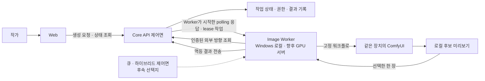
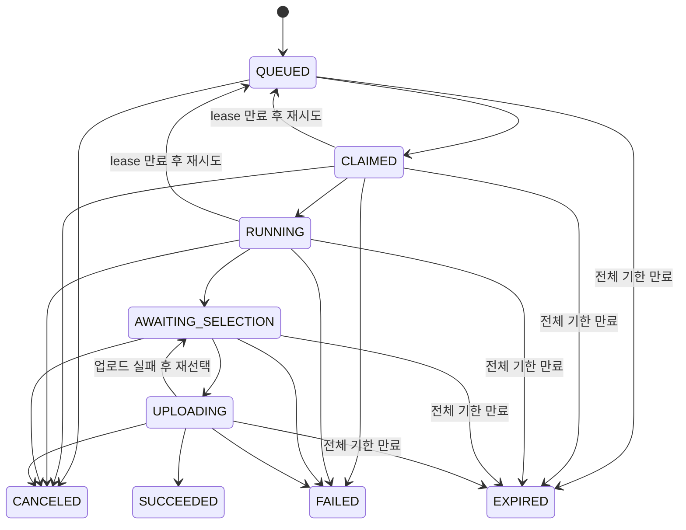
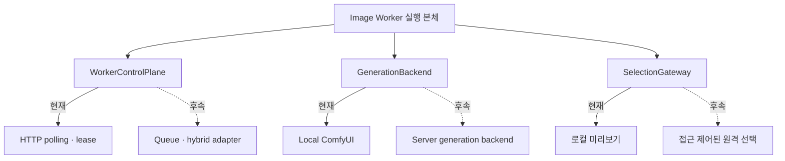
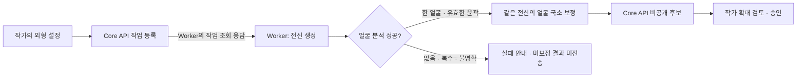

# Local-first Image Worker 사례 연구

> 초기 기록: 2026-09-04 · 후속 검증: 2026-09-21 · 상태: FACE·초기 전신 생성과 얼굴 분석 안정화 구현, 후속 버전의 실사용 배포·2기기 E2E는 별도

초기 설계와 당시 검증 기록을 보존하고, 이후의 [전신 생성·얼굴 분석 안정화](#후속-품질-개선-전신-생성과-얼굴-분석-안정화)를 아래에 추가했다. 앞부분의 로컬 수동 선택은 초기 구현이다. 후속 단일 결과 경로는 유효한 결과를 비공개 후보로 자동 전송하며, 작가의 최종 승인은 여전히 별도다.

## 해결하려던 문제

이미지 생성 모델은 일반 Web 요청보다 실행 시간이 길고 GPU 자원을 많이 사용한다. 초기 개인 프로젝트가 수요를 확인하기 전에 전용 GPU 서버부터 운영하면 장치 비용뿐 아니라 작업 분배, 동시 실행 제한, 모델 배포와 장애 복구까지 한꺼번에 떠안게 된다.

반대로 Web이 Windows 노트북의 ComfyUI를 직접 호출하면 사용자 장치에 인바운드 포트를 열어야 하고, 브라우저에 Worker 주소·인증·재시도 책임이 노출된다. 나중에 GPU 서버나 외부 제공자로 옮길 때 UI 계약도 다시 만들어야 한다.

초기 목표는 다음 세 가지였다.

- 검증된 Windows·NVIDIA GPU를 첫 생성 경로로 사용해 초기 운영 비용을 통제한다.
- Web과 GPU 실행 위치 사이에 Core API 제어면을 두어 권한과 작업 상태를 한곳에서 판단한다.
- 현재 HTTP polling을 사용하더라도 향후 큐·하이브리드 분배로 옮길 수 있는 경계를 먼저 만든다.

## 전체 구조

Web은 Worker나 ComfyUI의 위치를 알지 못하고 Core API만 호출한다. Worker가 서버를 주기적으로 조회하므로 서버가 방화벽이나 NAT 안의 사용자 PC에 직접 접속하지 않는다. ComfyUI는 Worker와 같은 장치에 머물고 외부 서비스 역할을 하지 않는다.

## Core API를 중간에 둔 이유

Core API는 단순한 중계기가 아니라 이미지 작업의 최종 판단 주체다.

- 현재 사용자와 작품 접근 권한 확인
- 중복 생성 방지와 작업 상태 전이 관리
- 실행 중 Worker가 유효한지 확인하는 lease와 오래된 실행 차단
- 네트워크 중단 후 재시도해도 같은 결과가 중복 등록되지 않는 멱등 처리
- 선택 결과의 파일 정책 확인과 비공개 후보 등록

이 경계 덕분에 Worker의 실행 위치가 사용자 노트북에서 전용 GPU 서버로 바뀌어도 Web의 요청 흐름과 작품 권한 모델은 유지할 수 있다.

## 긴 작업을 안전하게 다루는 방법

이미지 생성 도중 Worker나 네트워크가 끊길 수 있으므로 단발성 HTTP 응답만 기다리지 않는다. 작업은 제한된 실행 권한인 lease를 사용하고, 만료된 실행의 늦은 상태 보고는 새 실행을 덮어쓰지 못한다. 선택 또는 업로드 중 Worker가 재시작되면 서버의 미완료 상태와 로컬 메타데이터를 맞춰 같은 결과를 복구한다.

현재 polling 구현은 작업이 없을 때 호출 시점에 작은 무작위 편차를 주고, 연속 오류에는 상한이 있는 지수 backoff를 적용한다. 여러 Worker가 동시에 서버를 반복 호출하거나 장애를 증폭시키는 상황을 줄이기 위한 운영 안전장치다.

## 선택한 결과만 업로드

생성 후보 전체를 서버에 자동 전송하지 않는다. 먼저 Windows 장치에서 후보를 확인하고, 작가가 고른 한 장만 Core API로 보내 기존 캐릭터의 비공개 후보 이미지로 등록한다. 최종 승인은 별도 작가 동작으로 남긴다.

이 선택은 초기 단계에서 다음 비용과 위험을 줄인다.

- 선택하지 않은 생성물의 저장·전송 비용
- 민감할 수 있는 중간 결과의 불필요한 서버 보관
- 임시 후보 전체에 필요한 접근 제어와 자동 삭제 운영

향후 다른 기기에서 후보를 골라야 한다면 비공개 임시 저장소, 만료 정책과 콘텐츠 검토를 먼저 설계해야 한다.

## 큐로 옮길 수 있는 Worker 경계

Worker 실행 본체는 구체적인 HTTP client가 아니라 `WorkerControlPlane` 계약에 의존한다. 현재 어댑터는 Core API를 polling하지만, 처리량이 실제로 증가하면 큐 또는 HTTP·큐 하이브리드 어댑터로 교체할 수 있다. 생성 실행과 결과 선택도 별도 경계로 나눠 배포 위치의 차이가 작업 상태 로직에 퍼지지 않게 했다.

큐와 전용 GPU 서버는 아직 구현 완료가 아니다. 먼저 단일 사용자·단일 Worker 흐름을 검증하고, 측정된 대기 시간과 동시 실행 수가 필요성을 증명할 때 도입한다.

## 초기 검증 결과 (2026-09-04)

| 검증 항목        | 확인 결과                                                                                               |
| ---------------- | ------------------------------------------------------------------------------------------------------- |
| 실제 GPU 생성    | Windows 11, RTX 4070 Laptop GPU, ComfyUI 0.34.0에서 고정 SD 1.5 워크플로로 512×512 PNG 생성 성공        |
| 사전 검사        | GPU·VRAM, ComfyUI 버전, 필수 노드와 허용 모델을 생성 전에 확인                                          |
| 실제 생성 측정   | 단일 실행에서 Worker 약 6.2초, ComfyUI 약 5.9초, 최대 관찰 VRAM 약 3.18GiB                              |
| Worker 통합 검증 | 가짜 Core API와 실제 ComfyUI를 연결해 작업 수신, 실행 상태, lease, 로컬 선택과 multipart 결과 전송 확인 |
| 자동 검증        | Worker Ruff·Pyright 통과, pytest 43개 통과                                                              |

측정값은 한 종류의 장치에서 수행한 단일 기술 검증이며 일반적인 성능 기준이나 최소 GPU 요구사항을 의미하지 않는다. 모델 체크섬, 실제 프롬프트, 토큰, 내부 주소와 원문 로그는 공개 대상에서 제외했다.

## 초기 구현으로 얻은 결과와 당시 후속 범위

이번 구현으로 브라우저가 GPU 장치를 직접 호출하지 않으면서도 캐릭터 FACE 생성 요청부터 로컬 선택, 비공개 후보 등록까지 연결할 기반을 만들었다. 로컬 우선 전략을 최종 제약으로 고정하지 않고 Core API 제어면과 Worker 어댑터를 분리해 이후 배포 선택을 늦출 수 있게 한 것이 핵심이다.

아직 완료로 주장하지 않는 범위는 다음과 같다.

- Mac의 Web·Core API와 Windows Worker를 연결한 실제 2기기 E2E
- 더 낮은 VRAM과 다른 GPU·운영체제의 호환성
- 생성 이미지 콘텐츠 등급과 독자 공개 승인 정책
- 전용 GPU 서버, 외부 이미지 제공자와 실제 큐 분배
- 승인된 얼굴을 입력으로 사용하는 여러 각도 얼굴 일관성 워크플로

이 후속 검증은 사용자 수요, 운영 비용과 공개 정책을 확인한 뒤 같은 Core API 작업 경계 위에서 확장한다.

## 후속 품질 개선: 전신 생성과 얼굴 분석 안정화

> 확인일: 2026-09-21 · 구현 및 격리 GPU 검증 완료 · 실사용 환경 배포와 Mac↔Windows 왕복 검증은 미완료

### 목적: 재사용할 캐릭터 기준 자료 만들기

작가에게 필요한 것은 얼굴 한 장만이 아니라 얼굴·헤어·체형·의상 특징을 함께 검토할 수 있는 기준 이미지다. 승인한 기준 자료를 이후 에피소드의 상황별 삽화와 영상에 재사용하는 것이 목표다. 이번 단계가 다양한 장면·각도·영상에서 외형을 완전히 유지한다는 의미는 아니다.

초기 전신을 생성한 뒤 **그 전신에서 검출한 얼굴 영역만 저강도로 보정**하도록 연결했다. 별도로 생성한 얼굴을 몸에 붙이는 방식이 아니며, 캐릭터별 LoRA 학습을 이번 경로의 필수 조건으로 두지 않았다.

위 그림은 구현된 제품 흐름이다. 이번 실기기 검증은 전신 생성부터 보정·로컬 결과 저장까지이며, Core 후보 등록·권한·승인은 별도의 HTTP 통합 검사로 확인했다. 하나의 실제 두 장치 E2E를 완료한 것처럼 합쳐서 해석하지 않는다.

### 문제와 선택: 성공 기준을 낮추지 않고 분석 범위를 보완

전신에서는 얼굴이 차지하는 비율이 작아 전체 프레임 검사만으로 얼굴을 놓치는 입력이 있었다. 매번 새 이미지를 생성해 비교하면 프롬프트·시드·생성 편차가 섞이므로, 보정 전 이미지와 파일 무결성 정보를 고정해 구·신 분석에 같은 픽셀을 넣었다.

- 전체 프레임과 겹치는 구역을 함께 검사해 작은 얼굴을 분석할 기회를 보완했다.
- 전체 프레임에서 이미 성공한 입력은 기존 얼굴 영역을 우선해 정상 결과가 바뀌지 않게 했다.
- 모든 구역을 검사하고 중복 관측과 별도 얼굴을 구분했다. 먼저 발견한 얼굴 하나만 골라 성공 처리하지 않는다.
- 검출 없음, 복수·모호한 검출, 윤곽 분석 실패를 구분해 고정된 복구 안내로 변환했다. 엔진 원문 오류는 사용자에게 노출하지 않는다.
- 신뢰도 기준을 낮추거나 임의 얼굴 영역을 가정하지 않았다. 실패한 미보정 이미지는 성공 후보로 전송하지 않고 기존 승인본을 유지한다.

모델·프롬프트·시드·보정 강도를 고정하고 얼굴 위치 분석을 바꾼 실험이다. 단순히 더 큰 모델을 도입한 개선과 구분한다. 전체 얼굴을 언제나 검출한다는 보장은 없으므로 작가의 최종 검토는 유지한다.

### 버전과 서비스 경계 유지

새 분석은 워크플로 1.1.0으로 등록하고 기존 1.0.0과 노드 바이트를 보존했다. 모델·노드·워크플로의 버전과 무결성을 실행 전에 확인하며, 새 기능을 지원하지 않는 Worker에는 새 작업을 배정하지 않는다. 기존 작업의 복구 경로도 유지한다.

분석 로직이 달라져도 Web은 Core API만 호출한다. 인증·작품 소유권·작업 상태·lease·중복 결과 방지는 같은 경계에서 검사하므로, 이번 품질 개선이 로컬 Worker를 Web에 직접 노출하거나 향후 서버 배포 방식을 고정하지 않는다.

### 검증 결과와 해석 범위

실기기는 RTX 4070 Laptop 8GB, ComfyUI 0.34.0이며 SDXL 계열의 고정 체크포인트를 사용했다. 새 모델 설치나 추가 LoRA 학습 없이 검사했다.

| 검사                                    | 관측 결과                                     | 해석 범위                                                                    |
| --------------------------------------- | --------------------------------------------- | ---------------------------------------------------------------------------- |
| 고정 전신 4장의 CPU 얼굴 분석           | 구버전 3/4 → 새 버전 4/4 통과                 | 작은 회귀 평가 세트이며 일반 생성 성공률이 아님                              |
| 기존 성공 전신 3장                      | 얼굴 crop 픽셀·영역·윤곽 동일                 | 분석 변경으로 기존 입력이 달라지는지 검사                                    |
| 합성 빈 이미지·단일 얼굴·두 얼굴 대조군 | 빈 이미지·두 얼굴은 거절, 단일 얼굴은 통과    | 거절해야 할 입력의 안전 경계 검사                                            |
| 고정 실패 입력의 새 GPU 보정            | 얼굴 분석·보정·최종 저장 성공                 | 보존된 실패 입력 한 건의 복구 확인                                           |
| 같은 정상 입력의 구·신 GPU 보정         | 최종 RGB 전체 동일                            | 한 입력의 실제 sampler 재실행 비교이며 과거 결과 전체와의 동등성 주장은 아님 |
| 고정 입력 GPU 보정 3회                  | 얼굴 마스크 바깥 변경 0픽셀, 최대 채널 차이 0 | 원본 전신의 동일 확대본과 비교해 비얼굴 영역 보존 확인                       |
| 등록 1.1.0 전체 생성 1회                | 1152×2016 PNG, 처리 36.345초                  | 전신 생성→얼굴 보정→관리된 로컬 결과 저장까지 성공                           |

고정 입력의 보정 구간 검사와 등록 워크플로 전체 실행을 분리했다. 실행 이력에서 보정 sampler의 재실행을 확인했고, 전체 실행에서는 전신·보정 sampler가 모두 캐시 결과가 아님을 확인했다. 36.345초는 사전 해시 검사·Core 대기·업로드를 제외한 단일 관측값이다. 모델 로딩·캐시 상태가 다른 실행끼리 속도 개선율을 계산하거나 일반 처리시간으로 제시하지 않는다.

육안으로 전체 이미지와 얼굴 확대를 확인해 눈·입의 디테일 보완과 턱·헤어·목 경계를 검토했다. 보정으로 세부 인상이 달라질 수 있고 헤어 길이·앞머리·의상 설정 불일치도 남았다. **생성 완료, 캐릭터 설정 준수, 작가의 품질 승인은 서로 다른 판정**이다.

자동 검증은 CPU 단위 검사 13개와 동일 픽셀 재실행 7건을 통과했다. 최신 통합본의 프로젝트 전체 회귀 검사는 Core 754개·Web 445개·AI 157개·Worker 1,259개 통과이며, 기존 Windows 심볼릭 링크 권한 관련 2개는 건너뛰었다. 린트·타입·빌드·의존성 보안 검사도 통과했다. 이 수치는 이번 기능만의 신규 테스트 수가 아니다.

별도의 실제 HTTP·임시 PostgreSQL 호환 DB 검사에서는 신규 마이그레이션, 구버전 호환, 다른 사용자 접근 차단, 유효하지 않은 lease 거절, 실패 시 후보 미등록·기존 승인 유지와 업로드 멱등성을 확인했다. 저장소는 대체 구현을 사용했으므로 운영 DB·실제 오브젝트 저장소·Mac↔Windows GPU 결과 업로드까지 검증한 것은 아니다.

### 배운 점과 다음 범위

이번 개선의 핵심은 검출 통과 수만 올리는 것이 아니라 **실패 입력 복구와 기존 정상 결과 보존을 함께 증명하는 것**이었다. 같은 입력·실행 버전·검증 단계를 고정하니 개선 원인과 남은 한계를 구분할 수 있었다.

다음은 헤어·체형·의상 같은 설정 준수 평가, 승인 전신과 같은 출처의 얼굴 상세 자료, 필요한 각도·상황별 재사용 검증 순서다. 여러 캐릭터에 대한 일반화와 영상의 시간적 일관성은 후속 검증이며 자동 승인이나 서비스 배포 완료를 주장하지 않는다.

이 공개본에는 기술 설명·구조도·검증 요약만 포함한다. 내부 경로·프롬프트·모델 해시·원문 로그는 제외했고, 생성 이미지의 공개 권리와 메타데이터 검토가 끝나기 전에는 실제 결과 파일을 게시하지 않는다.
